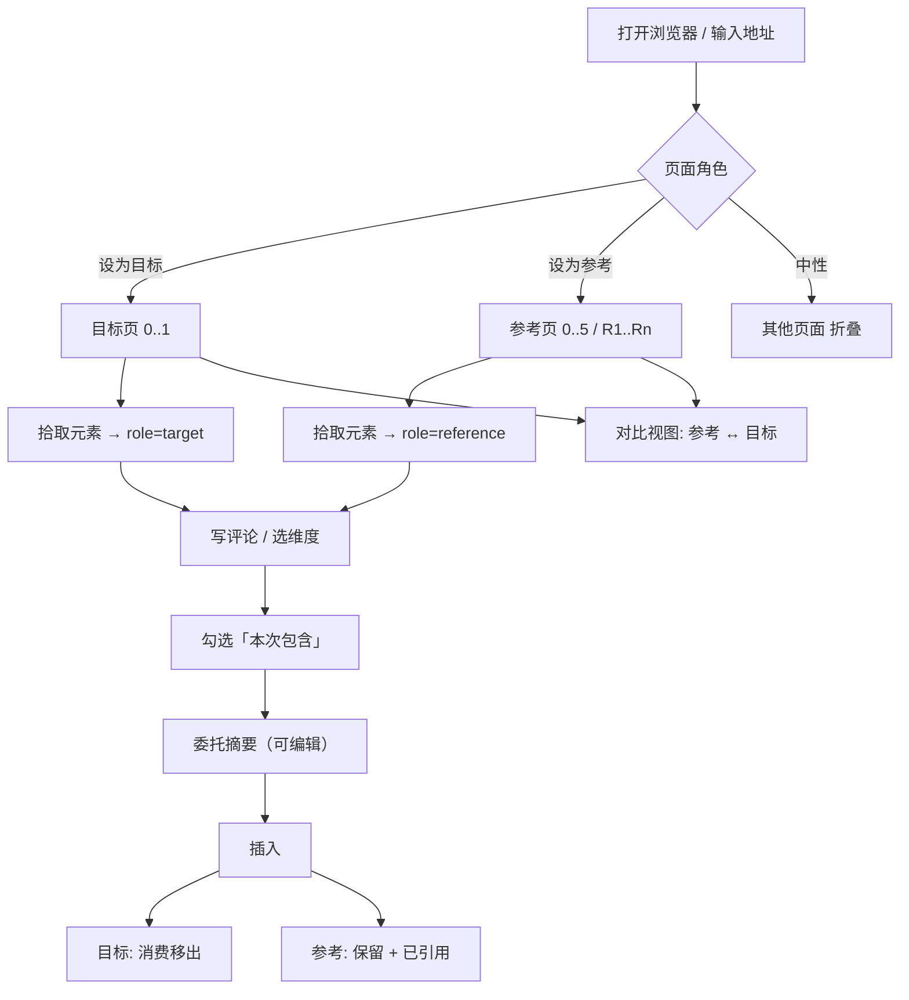
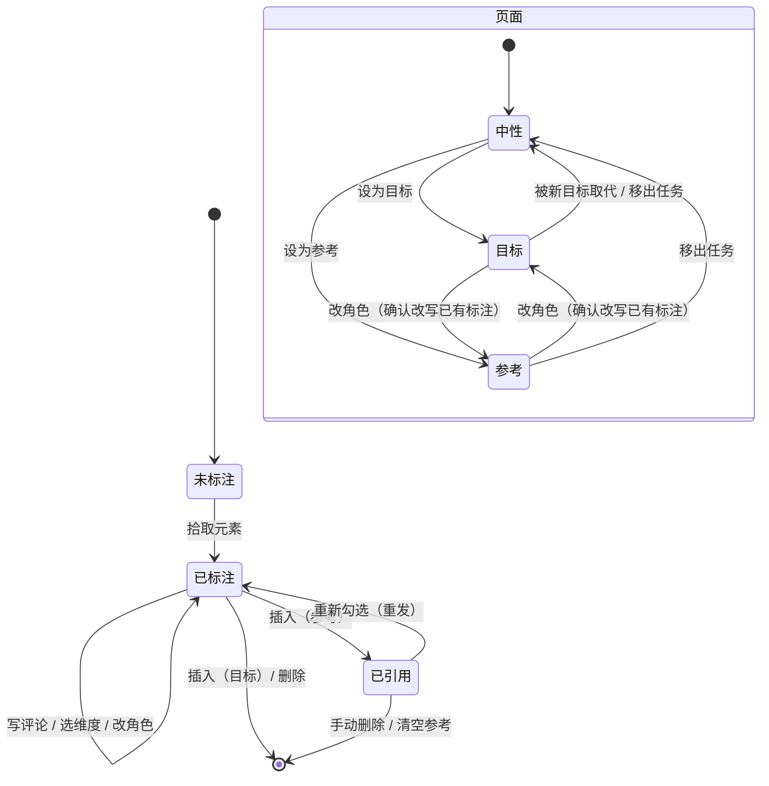

# 参考页标注（Reference Mode）设计规范

> 状态：已评审（2026-11-13），P0 实施中
> 范围：在现有「元素标注 → 插入对话」链路上增加页面/标注角色、参考集合与对比视图
> 相关代码：lib/session.js、lib/client.js、lib/overlay.js、lib/index.js、lib/shared/tool-schema.js

## 1. 问题与目标

现在的标注只有一种语义：**这些元素要改**。但真实工作中经常是「照着 A 页面把 B 页面做出来」：
用户需要在参考页上圈出布局/间距/配色，再把这些规范连同目标位置一起交给 agent。
现有模型没有角色、参考不可复用、多参考无法对比，agent 也无法区分「只读规范」与「改动对象」。

目标：

1. 一次任务里区分 **1 个目标页（可缺省）** 与 **0–5 个参考页**。
2. 参考标注可跨轮复用（插入后保留、标「已引用」），目标标注仍插入即消费。
3. 提供**面板内对比视图**：列表 / 对比两个视图共用同一个侧边栏面板，参考 ↔ 目标同屏，按需整页截图。
   对比不另开窗口——侧边栏才是常驻工作区，弹层会打断「标注 → 看对比 → 回标注」的循环。
4. 参考模式下插件交互与提示词都不同：文案、配色、chip、工具返回、硬约束。

## 2. 核心模型

```
任务 (task)
├── 目标页 target   0..1   改动对象（橙）
├── 参考页 reference 0..5   只读规范（蓝），R1..Rn
└── 标注 pick               role 继承页面，可单条覆盖
                            spec[] 记录参考维度
```

| 维度       | 目标 target    | 参考 reference                         |
| ---------- | -------------- | -------------------------------------- |
| 默认来源   | 当前唯一目标页 | 某个参考页                             |
| 插入后     | 消费、移出列表 | 保留，included=false / referenced=true |
| 再次插入   | 需重新标注     | 勾选后重发，卡片标「重发」             |
| Agent 语义 | 改这里         | 只读规范，禁止改参考页代码             |
| 视觉       | 橙色徽标       | 蓝色徽标 + R 编号                      |

**设计取舍**：不做会话级「参考模式」开关。同一页面内既指参考又指目标（照这个卡片做那个卡片）是真实场景，
会话级开关会把人卡死；页面给默认、单条可覆盖，日常零额外决策。

## 3. 信息架构



### 3.1 面板线框

```
┌ 指哪改哪 ──────────────────────────────┐
│ [https://…            ] [Chrome ⌄] [打开] │
│ 页面 4                        [＋ 参考页] │
│  目标  ● app.example.com        ⋯        │
│  参考  R1 ● linear.app  R2 ● dribbble.com │
│  其他  ● docs.example.com  （折叠 2）      │
├──────────────────────────────────────────┤
│ 标注模式 在页面里点击元素 · ⌥A      [●]   │
│ [ 标注 5 ][ 对比 4 ]                     │
│ [全部 5] [目标 2] [参考 3]               │
├──────────────────────────────────────────┤
│ 目标页 · 要改这里                          │
│  #1 button .btn-primary  ☑本次  [缩略图]  │
│ 参考页 R1 · linear.app · 只读              │
│  R1 div .card  ☑本次 [布局][间距] [缩略图] │
│  R2 div .card  ☐已引用 [配色]              │
├──────────────────────────────────────────┤
│ 本次委托（可编辑）                    ✎   │
│ [插入（3 参考 · 2 目标）] [清空⌄] [复制]   │
└──────────────────────────────────────────┘
```

分区职责：

- **Z1 页面条**：每个页面一枚 chip + 角色徽标。点 chip 切页；点徽标弹角色菜单（设为目标 / 设为参考 / 移出任务）。
  目标独占一行，参考按 R 编号横排，中性页收进「其他」。
- **Z2 标注模式**：开关文案随活动页角色变化。
- **Z2.5 视图切换**：标注 / 对比两个视图共用面板；对比不是弹窗，切过去就换掉面板主体内容。
- **Z3 过滤条**：全部 / 目标 / 参考。
- **Z4 列表**：按目标页、参考页 R1..Rn 分组；参考组可折叠。
- **Z5 委托摘要**：有勾选项时出现，确定性模板生成，可直接编辑。
- **Z6 CTA**：文案随组合变化；清空拆成「清空目标 / 清空参考 / 全部」。

## 4. 标注卡规格

沿用 .vp-card 骨架：

| 元素     | 目标卡          | 参考卡                                     |
| -------- | --------------- | ------------------------------------------ |
| 徽标     | 「目标」（橙）  | 「R1」（蓝）+ 页面标题                     |
| 缩略图   | 96×72，点击定位 | 同左                                       |
| 维度标签 | 无              | 布局/间距/配色/字号/圆角/交互/文案，可多选 |
| 评论占位 | 想怎么改？…     | 要参考这里的什么？…                        |
| 勾选     | ☑ 本次包含      | 同左；插入后自动取消                       |
| 状态戳   | —               | 已引用 / 重发                              |
| 单条按钮 | 插入            | 加入参考                                   |

状态：默认 / 悬停 / 焦点 / 保存中·已保存·失败 / 已引用未勾选（弱化）/ 页面已关闭 / 角色被覆盖 /
无截图 / 窄容器 <320px（竖排）。

## 5. 状态机



规则表：

| 场景     | 行为                                                           |
| -------- | -------------------------------------------------------------- |
| 标注继承 | 拾取时 role=页面角色、roleSource='page'；单条改角色则 'user'   |
| 参考上限 | 第 6 个被拒：「最多 5 个参考页，先移除一个」                   |
| 同 URL   | pageKey 去重，重开自动挂回                                     |
| 目标切换 | 旧目标降为中性页，标注保留并标「页面非当前目标」，toast 可撤销 |
| 页面关闭 | 不删标注，pageClosed 派生；对比视图显示占位                    |
| 改角色   | 弹确认「把已标的 N 条也改成参考/目标？」，默认勾选             |
| 插入     | 只发 included=true；目标消费移除，参考标已引用并取消勾选       |
| 撤销     | 恢复目标卡 + 参考 included/referenced 快照（复用 /restore）    |

## 6. 对比视图（面板内）

页面条下方是视图切换条 [ 标注 N ][ 对比 M ]，和列表共用同一个侧边栏面板——不弹新窗口，不遮挡对话。
对比态下每个页面一栏：栏头是角色徽标 + 标题 + 独立缩放（50–200%）+「截整页」，栏体是该页整页截图
（CDP captureBeyondViewport 单次成像，按需拉取，失败可重试），底部缩略条换栏。
面板窄时上下堆叠（每栏 min-height 120px、各自滚动）；面板拉宽到 ≥520px 自动并排。
Esc 从对比回列表；再点「标注」页签同样回列表。

## 7. 参考页悬浮层

- 胶囊：开启标注 → 标注参考，蓝色「参考」角标
- 控制台：参考已标 N 处；完成并插入 → 完成·加入参考
- 卡片：R1 标题 + 维度 chips + 占位「要参考这里的什么？」
- 首次进入拾取时顶部 transient note：「参考模式：这里只取规范，不会修改此页」
- 快捷键不变：⌥A / Esc / ⌘⏎

## 8. Agent 载荷与提示词

### 8.1 chip

```
[标注 #3｜目标] 主按钮 ｜ .btn-primary · app.example.com/app · (120,340) 88×32px
[标注 #R1-1｜参考 R1] 卡片布局 ｜ .card · linear.app · (240,180) 320×210px
```

### 8.2 工具 markdown

```markdown
页面元素标注（3 处：1 目标 / 2 参考）

## 参考页 R1 — linear.app（只读规范，禁止修改此页或其代码）

R1-1. .card — div：…
参考维度：布局、间距
评论：卡片内边距 16、圆角 12
截图：…

## 目标页 — app.example.com/app（要改这里）

T1. .btn-primary — button：…
```

### 8.3 委托摘要模板（确定性，不调模型）

- 参考 + 目标：参考 {R 列表} 的{维度并集}，在目标页 {标题} 上调整。
- 只有参考：按 {R 列表} 的{维度并集}新建页面。
- 无维度：退化为参考 {R 列表} 的写法，在目标页 {标题} 上调整。

### 8.4 工具契约

pick 新增 role、roleSource、pageKey、pageTitle、spec[]、referenced；参数新增可选 roles。
描述追加：「role=reference 的标注来自参考页，只用于提取视觉/交互规范，禁止修改参考页对应代码。
role=target 才是改动对象。目标页可能为 0，此时按参考新建页面。」
**仍然不能写 type 数组或 enum**：DSH 注册表只收单 type + oneOf。

## 9. 文案表

| 位置             | 文案                                                           |
| ---------------- | -------------------------------------------------------------- |
| 参考页空         | 在同一浏览器里打开想参考的页面，像平时一样标注                 |
| 目标页空         | 还没选目标页 —— 本次将按参考新建页面                           |
| 参考无标注       | 先在参考页上点选要参考的区域                                   |
| 对比无截图       | 还没有整页截图 —— 点这一栏右上角「截整页」                     |
| 参考上限         | 最多 5 个参考页，先移除一个                                    |
| 目标切换         | 目标页从 A 切到 B？原目标页会移出任务，已标的 2 条目标标注保留 |
| 参考插入成功     | 3 条参考已插入，会保留在列表并标为已引用                       |
| 目标插入成功     | 2 条目标标注已插入并从列表移除 · 撤销                          |
| 角色改写确认     | 把已标的 3 条也改成参考？                                      |
| 页面关闭         | 页面已关闭 · 重新打开后自动挂回                                |
| 整页失败         | 整页截图失败 · 重试                                            |
| CTA（参考+目标） | 插入（3 参考 · 2 目标）                                        |
| CTA（只有参考）  | 照参考新建（3 参考）                                           |

## 10. 数据契约

```js
pick: {
  id, selector, tag, url, text, comment, pageRect, shotPath,
  role: 'target' | 'reference',
  roleSource: 'page' | 'user',
  pageKey, pageTitle,
  spec: string[],
  included: boolean,
  referencedAt: number | null,
}
page: { key, url, title, role: 'target' | 'reference' | 'neutral', refIndex, targetId, fullShotPath }
```

路由（挂 /api/visual-annotator，沿用 DSH 凭据守卫）：

- POST /page-role {targetId, role}：唯一目标、上限 5、同页去重
- POST /pick-role、POST /pick-include、POST /pick-spec
- POST /pageshot {targetId}、GET /pageshot?key=…：按需整页截图
- POST /consume {ids, kind}：参考=标已引用，目标=移出
- GET /state 增补 pages[]、activePageKey

## 11. 落地拆分

**P0**：页面角色 + 单条覆盖；页面条分组/过滤条/参考卡；参考悬浮层；插入语义；委托摘要；
面板内对比视图（2-up + 缩略条 + 独立缩放 + 按需整页 + 失败态）；chip / 工具 markdown / 硬约束。

**P1**：同步缩放/滚动、参考组折叠记忆、跨轮参考集合。

**P2**：显式配对、叠加对照、3+ 栏、参考模板沉淀。

## 12. 验收清单

- [ ] 标记参考页后拾取 → role=reference，面板显示蓝色 R1 徽标
- [ ] 插入 2 参考 + 1 目标：参考卡仍在且 included=false / referenced=true，目标卡消失；撤销全部复原
- [ ] 勾选已引用参考再插入 → 标「重发」，不重复消费
- [ ] 目标页为 0 时 CTA 为「照参考新建（N 参考）」且可插入
- [ ] 第 6 个参考页被拒并提示
- [ ] 工具 markdown 含「只读规范」分区，role 字段完整，schema 仍只用单 type
- [ ] 对比视图：面板内切换、Esc 回列表、缩略条换栏、整页失败可重试、窄面板上下堆叠
- [ ] npm run verify 全绿（三契约 + canary）
